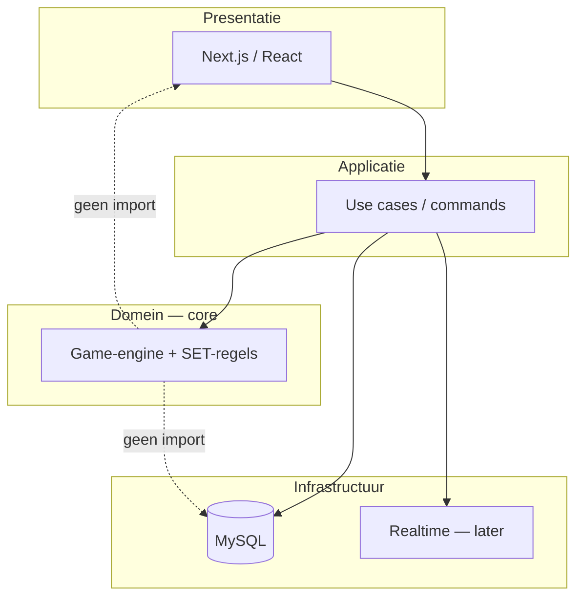

# Management samenvatting

## Project

**SET Game v2 Pro Style** — een onderhoudbare SET-game met professionele architectuur: herbruikbare spelregels (core), modulaire features (accounts, lobbies, statistieken) en uitbreidbare gamemodes.

## Probleem en kans

Veel spelimplementaties mengen UI, database en regels in één codebase. Dat levert snel een demo op, maar maakt multiplayer, nieuwe modes en betrouwbare tests duur. We investeren vroeg in scheiding van verantwoordelijkheden zodat de **zelfde engine** solo, lokaal en online kan dienen.

## Aanpak in het kort

## Eerste oplevering (mijlpaal M1)

**“Speelbare Classic SET op een solide technische basis”**

- Functionele specificatie Classic + domeintypes vastgelegd  
- Projectfundament: lint, typecheck, tests, mapstructuur, foutafhandeling  
- Docker Compose: app + MySQL 8.4 + migraties  
- **Pure game-core** met unit tests (SET-validatie, deck, acties, scoring)  
- Eerste UI: bord, kaarten (SVG), selectie, score, feedback — **geen** duplicatie van regels in React  

**Bewust buiten M1:** registratie/login, multiplayer, Time Attack, leaderboards.

## Vervolg (M2–M4, indicatief)

| Mijlpaal | Inhoud |
|----------|--------|
| **M2** | Accounts, sessies, spelresultaten gekoppeld aan gebruiker |
| **M3** | Gamemode-contract + Time Attack als proof of extensibility |
| **M4** | Lobby + online multiplayer (server-authoritative, realtime) |
| **M5** | Leaderboards + persoonlijke statistieken (solo `game_sessions`) |

## Succescriteria (project)

1. Spelregels zijn **100% testbaar zonder browser of database**.  
2. Geen `if (mode === "…")` verspreid over de UI; modes via expliciet contract.  
3. `npm run lint`, `typecheck`, `test` (en later `test:e2e`) zijn verplichte poort voor “klaar”.  
4. Database-only via migraties; geen secrets in Git.  
5. Documentatie van niet-triviale architectuurkeuzes (ADR).

## Planning (indicatief, solo/klein team)

| Fase | Focus | Richting duur |
|------|--------|----------------|
| 1 | Specificatie + domein | 2–4 dagen |
| 2 | Projectfundament | 2–3 dagen |
| 3 | Docker + DB | 2–3 dagen |
| 4 | Game-core | 4–7 dagen |
| 5 | Classic UI | 4–7 dagen |
| **M1 totaal** | | **~3–4 weken** (deeltijd) |
| 6–9 | Accounts, modes, MP, productie | iteratief |

Exacte planning wordt per sprint verfijnd in [Implementatieplan](./06-implementatieplan.md).

## Belangrijkste risico’s

- Scope creep vóór M1 (accounts/multiplayer te vroeg) → **strikt M1-scope**.  
- Core per ongeluk gekoppeld aan Next.js → **import-lint / package boundaries**.  
- Multiplayer complexiteit → **HTTP-first**, realtime pas bij M4.  

Zie [Risico’s en beslissingen](./11-risicos-en-beslissingen.md).
