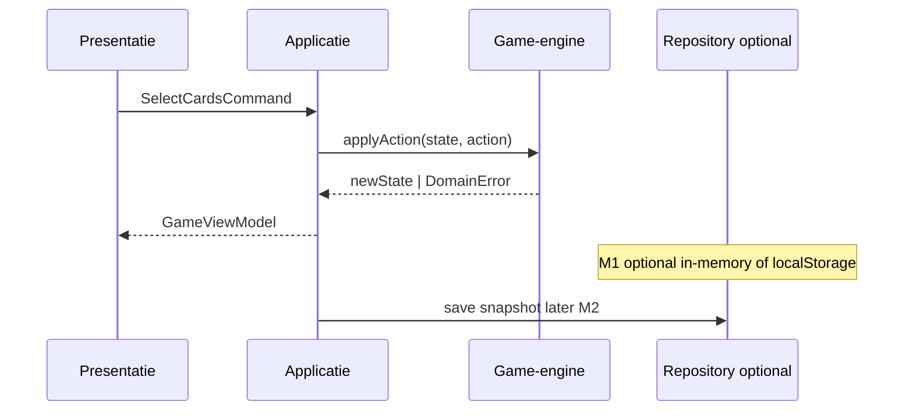
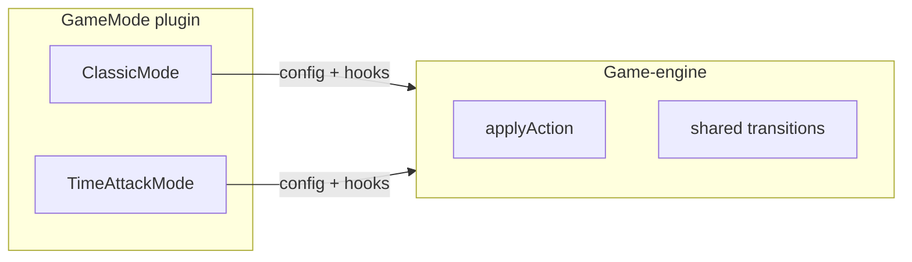

# Architectuur

## Lagenoverzicht

| Laag | Verantwoordelijkheid | Technologie (indicatief) |
|------|----------------------|---------------------------|
| **Presentatie** | Pagina’s, componenten, client state voor UX | Next.js App Router, React, Tailwind |
| **Applicatie** | Use cases: start spel, dien zet, beëindig ronde; autorisatie | TypeScript services, command handlers |
| **Domein (core)** | Kaarten, SET, spelstatus, acties, scoring, mode-contract | Pure TS, geen I/O |
| **Infrastructuur** | MySQL, repositories, sessies, logging, realtime | mysql2/Drizzle/Prisma (keuze ADR), WebSockets later |

## Module-indeling

### Globale core (`src/core/`)

Gedeeld door alle gamemodes en door server/client.

```
core/
├── cards/           # Card type, deck generatie, shuffle
├── set-rules/       # isValidSet, findSets
├── game-engine/     # state machine, applyAction
├── game-modes/      # mode registry + Classic (+ later Time Attack)
└── scoring/         # score berekening per mode
```

**Regel:** `core/**` mag niet importeren uit `app/`, `modules/*/presentation`, `infrastructure/database`, `next/*`, `react`.

### Feature modules (`src/modules/`)

Vertical slices per bounded context:

| Module | M1 | Later |
|--------|----|-------|
| `games` | Solo Classic orchestration | Historie, herstel |
| `accounts` | — | Auth, profiel |
| `lobbies` | — | Kamers, invites |
| `multiplayer` | — | Sync, authoritative server |
| `statistics` | — | Aggregaten |
| `leaderboards` | — | Rankings |

Intern per module (waar zinvol):

```
modules/games/
├── domain/          # module-specifieke entiteiten (b.v. SavedGame id)
├── application/     # StartClassicGame, RecordResult
├── infrastructure/  # GameRepository
└── presentation/    # hooks, view models (optioneel)
```

### Gedeelde infrastructuur (`src/infrastructure/`)

Cross-cutting: database client, config loader, logger — **niet** spelregels.

### Next.js (`src/app/` of migratie van `app/`)

- Route groups: `(auth)`, `(game)`  
- API routes: dunne laag → application services  
- Geen businesslogica in `route.ts` beyond validatie + mapping.

## Data- en controlflow (solo Classic)



## Multiplayer (ontwerp voor later)

| Concept | Beschrijving |
|---------|--------------|
| **Authoritative server** | Server houdt canonical `GameState`; clients tonen projections. |
| **GameId vs PlayerId** | Spel en deelnemers zijn aparte identifiers. |
| **Commands** | Client stuurt intentie; server valideert met core en broadcast nieuwe state. |
| **Concurrency** | Optimistic locking: versie/seq op game row; conflict → retry of fout. |
| **Privacy** | Deck en verborgen kaarten niet naar client lekken (indien mode dat vereist). |
| **Transport** | M1–M3: HTTP REST; M4: WebSockets of SSE voor push + HTTP voor commands. |

## Gamemodes als plug-in



**GameMode contract** (conceptueel):

- `id`, `displayName`, `defaultConfig`  
- `createInitialState(config, rng?)`  
- `validateAction(state, action)` — mode-specifiek bovenop shared SET-regels  
- `onActionApplied(state, action, result)` — scoring, timer, beurt  
- `isGameOver(state)`  
- Optioneel: `visibleStateForPlayer(state, playerId)` voor multiplayer  

Geen mode-switch statements in UI; UI kiest mode via config/route en laadt juiste presenter.

## Migratie huidige repo

Huidige structuur: `app/` op repository-root (create-next-app).

**Aanbevolen:** naar `src/app/` migreren zodat `src/core` en `src/modules` naast elkaar leven; `tsconfig` paths `@/core/*`, `@/modules/*`.

Stap in fase 2 van implementatieplan; geen functionele wijziging.

## Architectuurkwaliteit bewaken

1. **ESLint** `no-restricted-imports` voor `core/**`.  
2. **Tests** alleen in `core` en `application` voor regels.  
3. **ADR** bij keuze ORM, auth library, realtime library.

Zie [Technische projectstructuur](./05-technische-structuur.md).
