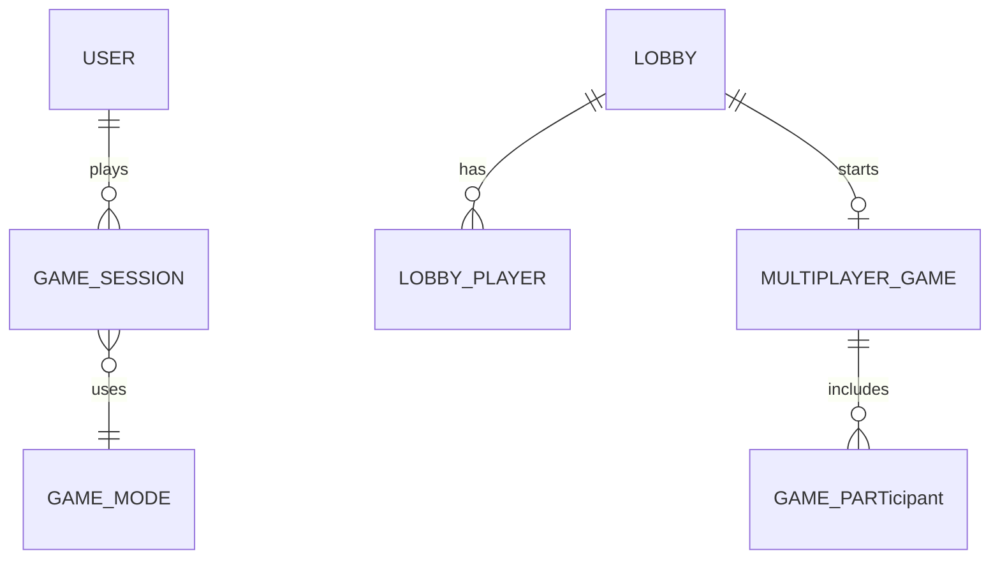

# Domeinmodellen

TypeScript-achtige definities; implementatie in `src/core` en `src/modules`. Deze modellen ondersteunen M1 en voorbereiden M2–M4 **zonder** M1 alles te persisteren.

## 1. Core — kaarten

```typescript
type NumberCount = 1 | 2 | 3;
type Shape = "diamond" | "squiggle" | "oval";
type Shading = "solid" | "striped" | "open";
type Color = "red" | "green" | "purple";

type CardAttributes = {
  number: NumberCount;
  shape: Shape;
  shading: Shading;
  color: Color;
};

type CardId = string; // bijv. "n1-diamond-solid-red" of encoded index

type Card = {
  id: CardId;
  attributes: CardAttributes;
};
```

## 2. Core — deck

```typescript
type Deck = {
  drawPile: CardId[]; // top = index 0
  discardPile: CardId[];
};

type CardCatalog = ReadonlyMap<CardId, Card>; // alle 81
```

**Operaties (pure):** `createFullDeck()`, `shuffle(catalog, seed)`, `draw(deck, n)`.

## 3. Core — SET

```typescript
type CardTriple = readonly [CardId, CardId, CardId];

function isValidSet(a: Card, b: Card, c: Card): boolean;

function findSets(
  board: readonly CardId[],
  catalog: CardCatalog
): CardTriple[];
```

## 4. Core — spelacties

```typescript
type GameAction =
  | { type: "SELECT_TOGGLE"; cardId: CardId }
  | { type: "SUBMIT_SET"; cardIds: readonly [CardId, CardId, CardId] }
  | { type: "DEAL_EXTRA" }
  | { type: "NEW_GAME"; seed?: string }
  | { type: "QUIT" };

type GameStatus = "playing" | "ended";

type EndReason =
  | "deck_empty"
  | "no_set_remaining"
  | "player_quit"
  | "time_up"; // Time Attack later
```

**M1 note:** selectie kan in UI leven; engine accepteert direct `SUBMIT_SET` + `DEAL_EXTRA`. Optioneel: engine houdt `selectedCardIds` voor replay/tests.

## 5. Core — Classic state

```typescript
type ClassicGameConfig = {
  modeId: "classic";
  initialBoardSize: 12;
  dealExtraSize: 3;
  pointsPerSet: 1;
};

type ClassicGameState = {
  modeId: "classic";
  status: GameStatus;
  endReason?: EndReason;
  config: ClassicGameConfig;
  catalog: CardCatalog;
  deck: Deck;
  board: CardId[];
  score: number;
  moves: number; // aantal submit pogingen — statistiek
  validSetsFound: number;
  rngSeed: string; // audit / replay
};
```

## 6. Core — engine result

```typescript
type ApplyResult =
  | { ok: true; state: ClassicGameState; events: GameEvent[] }
  | { ok: false; error: DomainError };

type GameEvent =
  | { type: "SET_FOUND"; cardIds: CardTriple }
  | { type: "SET_INVALID"; cardIds: CardTriple }
  | { type: "CARDS_DEALT"; cardIds: CardId[]; reason: "replace" | "extra" }
  | { type: "GAME_ENDED"; reason: EndReason };

type DomainError = {
  code:
    | "INVALID_ACTION"
    | "GAME_NOT_PLAYING"
    | "CARD_NOT_ON_BOARD"
    | "DECK_EMPTY"
    | "CANNOT_DEAL_EXTRA";
  message: string;
};
```

**Publieke API (indicatief):**

- `createInitialClassicState(config, seed): ClassicGameState`  
- `applyAction(state, action): ApplyResult`  
- `getLegalHints(state): { canDealExtra: boolean; hasSetOnBoard: boolean }`  

## 7. Gamemode contract (voor M3)

```typescript
interface GameMode<S extends BaseGameState, C> {
  readonly id: string;
  createInitialState(catalog: CardCatalog, config: C, seed: string): S;
  applyAction(state: S, action: GameAction): ApplyResult<S>;
  isGameOver(state: S): boolean;
  score(state: S): number;
}
```

Classic is eerste implementatie.

## 8. Applicatie — use cases (M1)

| Command | Input | Output |
|---------|-------|--------|
| `StartClassicGame` | `{ seed? }` | `ClassicGameState` |
| `PerformGameAction` | `{ state, action }` | `ApplyResult` |

M1 kan in-memory state in React houden; interface blijft gelijk voor later server persistence.

## 9. Persistentie — entiteiten (M2+, schema schets)

Zie [Data en database](./07-data-en-database.md). Conceptueel:

```typescript
type UserId = string;
type GameSessionId = string;

type User = {
  id: UserId;
  username: string;
  email?: string;
  passwordHash: string; // Argon2id
  createdAt: Date;
};

type GameSession = {
  id: GameSessionId;
  userId: UserId | null; // null = anonymous M1
  modeId: string;
  startedAt: Date;
  endedAt?: Date;
  finalScore?: number;
  snapshotJson?: string; // optioneel replay
};
```

## 10. Multiplayer — entiteiten (M4)

```typescript
type LobbyId = string;
type PlayerId = string;

type Lobby = {
  id: LobbyId;
  hostPlayerId: PlayerId;
  status: "open" | "in_game" | "closed";
  maxPlayers: number;
};

type GameParticipant = {
  playerId: PlayerId;
  userId?: UserId;
  displayName: string;
  seatOrder: number;
  score: number;
  connected: boolean;
};

type MultiplayerGameState = ClassicGameState & {
  gameId: string;
  version: number; // optimistic concurrency
  participants: GameParticipant[];
  currentTurnPlayerId?: PlayerId; // indien turn-based
};
```

## 11. Relatiediagram (conceptueel)



M1 implementeert alleen **ClassicGameState** + **CardCatalog** in code; overige tabellen gemigreerd maar optioneel leeg.
