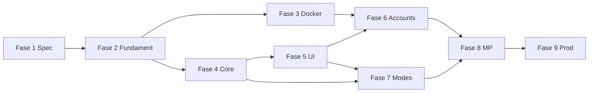

# Implementatieplan — fasen 1 t/m 9

Elke fase heeft **doel**, **taken**, **deliverables** en **exit criteria**. Volgorde is bindend voor M1; fase 6+ kan deels parallel na M1.

---

## Fase 1 — Functionele specificatie en domein

**Doel:** Eenduidige regels en types vóór code in core.

| # | Taak | Owner | Output |
|---|------|-------|--------|
| 1.1 | Review [Functionele specificatie](./03-functionele-specificatie.md); sluit OB-* af | Product/dev | Bijgewerkte §9 |
| 1.2 | Finaliseer [Domeinmodellen](./04-domeinmodellen.md) | Dev | Types frozen voor M1 |
| 1.3 | Lijst publieke engine-functies + event lijst | Dev | § in ADR of core README |
| 1.4 | Acceptatiecriteria → testnamen mapping | Dev | Tabel in test plan |

**Deliverables:** Goedgekeurde spec + domein §1–6; open punten ≤ 2.

**Exit criteria:**

- [ ] Geen tegenstrijdige regels in spec  
- [ ] Classic scoring en einde-spel gedefinieerd  
- [ ] Stakeholder akkoord op M1-scope  

**Duur:** 2–4 dagen  

---

## Fase 2 — Projectfundament

**Doel:** Schone, gecontroleerbare basis.

| # | Taak | Details |
|---|------|---------|
| 2.1 | Migratie `app/` → `src/app/` | Update imports, next config |
| 2.2 | Mappen `src/core`, `src/shared`, `src/infrastructure` (skelet) | Lege index waar nodig |
| 2.3 | Vitest + eerste smoke test | `npm run test` |
| 2.4 | `npm run typecheck` script | CI-ready |
| 2.5 | ESLint config + import restrictions voor core | |
| 2.6 | Prettier (optioneel) of ESLint stylistic | Team preference |
| 2.7 | `shared/errors` — DomainError base | |
| 2.8 | `infrastructure/configuration` — Zod env (stub) | |
| 2.9 | README project-specifiek | Link plan-van-aanpak |

**Deliverables:** Groene lint + typecheck + test (smoke).

**Exit criteria:**

- [ ] `npm run dev` werkt na src-migratie  
- [ ] Core map bestaat; restricted imports actief  
- [ ] Geen secrets in repo  

**Duur:** 2–3 dagen  

---

## Fase 3 — Docker en database

**Doel:** Reproduceerbare dev-omgeving + migraties.

| # | Taak | Details |
|---|------|---------|
| 3.1 | `compose.yaml`: mysql:8.4 + app | Healthcheck DB |
| 3.2 | `.env.example` + docker env | |
| 3.3 | ADR: ORM/query layer keuze | Drizzle vs Prisma vs raw |
| 3.4 | Eerste migratie: users + game_sessions (minimaal) | Zie [07-data](./07-data-en-database.md) |
| 3.5 | `db:migrate` in compose entrypoint of script | |
| 3.6 | Integration test: DB connect | tests/integration |

**M1 note:** App gebruikt DB nog niet voor gameplay; wel connectie bewezen.

**Exit criteria:**

- [ ] `docker compose up` → app + mysql healthy  
- [ ] Migraties idempotent  
- [ ] DB niet public exposed in prod compose profile  

**Duur:** 2–3 dagen  

---

## Fase 4 — Pure game-core

**Doel:** Betrouwbare engine, 100% UI-vrij.

| # | Taak | Module |
|---|------|--------|
| 4.1 | `Card`, catalog, 81 generatie | `core/cards` |
| 4.2 | `shuffle`, `draw` met seeded RNG | `core/cards` |
| 4.3 | `isValidSet`, attribute helpers | `core/set-rules` |
| 4.4 | `findSets` (combinatoriek 12→C(12,3)) | `core/set-rules` |
| 4.5 | `ClassicGameState`, `createInitialClassicState` | `core/game-engine` |
| 4.6 | `applyAction` — SUBMIT_SET, DEAL_EXTRA, NEW_GAME, QUIT | `core/game-engine` |
| 4.7 | Events + `getLegalHints` | `core/game-engine` |
| 4.8 | Scoring Classic | `core/scoring` |
| 4.9 | Classic mode wrapper | `core/game-modes/classic` |
| 4.10 | Tests: alle AC-* uit spec + edge cases | `*.test.ts` |

**Edge cases verplicht in tests:**

- Deck leeg tijdens replace  
- Deal extra wanneer SET wél bestaat → fout  
- Dubbele cardId in submit → fout  
- Bord met 15+ kaarten na deals  

**Exit criteria:**

- [ ] ≥ 95% coverage op `set-rules` + `game-engine` (richtlijn)  
- [ ] Geen imports uit next/react in core  
- [ ] Alle AC-SET-01 t/m 05 groen  

**Duur:** 4–7 dagen  

---

## Fase 5 — Eerste speelbare interface (M1)

**Doel:** Classic speelbaar; UI roept application/core aan.

| # | Taak | Details |
|---|------|---------|
| 5.1 | Route `(game)/play` | |
| 5.2 | `CardView` SVG component | 4 attributen visueel |
| 5.3 | `Board` grid + selectie state | Max 3 select |
| 5.4 | Hook `useClassicGame` → Start + applyAction | Geen isValidSet in UI |
| 5.5 | Score, status, ended overlay | |
| 5.6 | Feedback invalid SET / deal extra knop | Conditie via `getLegalHints` |
| 5.7 | Responsive layout + Tailwind | |
| 5.8 | E2E: happy path en invalid SET | Playwright |

**Exit criteria:**

- [ ] Volledig spel te spelen in browser  
- [ ] Regressie: unit tests blijven groen  
- [ ] E2E in CI (optioneel self-hosted)  

**Duur:** 4–7 dagen  

### 🎯 Mijlpaal M1

Alle exit criteria fase 1–5 + [Kwaliteit M1](./10-kwaliteit-en-delivery.md#m1-gate).

---

## Fase 6 — Accounts en sessies

**Doel:** Eigen accounts; spel gekoppeld aan user.

| # | Taak |
|---|------|
| 6.1 | Module `accounts`: register, login, logout |
| 6.2 | Argon2id password hashing |
| 6.3 | Sessiecookies HttpOnly, Secure prod, SameSite=Lax |
| 6.4 | Middleware/route protection `(game)/dashboard` |
| 6.5 | `GameSession` persistence bij einde spel |
| 6.6 | Tests: auth flows integration |

Zie [08-beveiliging](./08-beveiliging-en-accounts.md).

**Exit criteria M2:**

- [ ] Geen plaintext wachtwoorden  
- [ ] Session fixation mitigatie (rotate on login)  
- [ ] OWASP baseline checklist afgevinkt  

**Duur:** 1–2 weken  

---

## Fase 7 — Gamemode-architectuur + Time Attack

**Doel:** Bewijs dat uitbreiding zonder core fork werkt.

| # | Taak |
|---|------|
| 7.1 | Formaliseer `GameMode` interface + registry |
| 7.2 | Refactor Classic naar plugin |
| 7.3 | Spec Time Attack (timer, score formule) |
| 7.4 | Implement Time Attack mode |
| 7.5 | Mode selector UI |
| 7.6 | Tests mode-specifiek |

**Exit criteria M3:**

- [ ] Geen mode if-else in engine core buiten registry |
- [ ] Time Attack speelbaar solo  

---

## Fase 8 — Lobby en multiplayer

**Doel:** Online spelen; server is waarheid.

| # | Taak |
|---|------|
| 8.1 | Modules `lobbies`, `multiplayer` |
| 8.2 | HTTP API: create/join lobby, start game |
| 8.3 | Authoritative `applyAction` op server |
| 8.4 | Version/seq concurrency op game row |
| 8.5 | Realtime: WebSocket/SSE keuze (ADR) |
| 8.6 | Reconnect + stale state sync |
| 8.7 | `visibleStateForPlayer` indien nodig |

Zie [09-gamemodes-en-multiplayer](./09-gamemodes-en-multiplayer.md).

**Exit criteria M4:**

- [ ] 2 clientszelfde spel; geen dubbele SET claim  
- [ ] Disconnect/reconnect gedocumenteerd  

---

## Fase 8b — Leaderboards en statistieken (M5)

**Doel:** Rankings en inzicht uit opgeslagen solo-spellen.

| # | Taak |
|---|------|
| 8b.1 | Modules `leaderboards`, `statistics` |
| 8b.2 | Queries op `game_sessions` (per mode, personal best + top runs) |
| 8b.3 | API + `/leaderboards` UI |
| 8b.4 | Dashboard statistiekkaarten |
| 8b.5 | Index migratie voor leaderboard |

**Exit criteria M5:**

- [ ] Leaderboard toont resultaten per mode na ingelogd spelen  
- [ ] Dashboard toont aggregaten per gebruiker  

---

## Fase 9 — Afronding productie

| # | Taak |
|---|------|
| 9.1 | E2E suite uitbreiden |
| 9.2 | Security review (auth, CSRF, rate limit) |
| 9.3 | Structured logging + request ids |
| 9.4 | Performance smoke (board findSets) |
| 9.5 | Backup/restore DB procedure |
| 9.6 | Prod compose / deploy doc |
| 9.7 | Monitoring hooks (health endpoint) |

**Exit criteria:** Go-live checklist [§ Productie](./10-kwaliteit-en-delivery.md#productie-gate).

---

## Dependency tussen fasen

## Volgende actie (direct)

1. Open punten OB-01 in [03-functionele-specificatie](./03-functionele-specificatie.md) bevestigen.  
2. Start **Fase 2** in repo (src-migratie + Vitest).  
3. Parallel **Fase 4** kan na 2.2 al beginnen (core zonder Docker).
