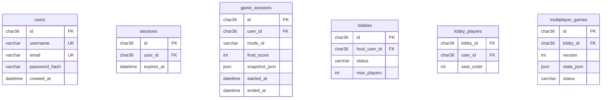

# Data en database

MySQL 8.4 als system of record voor accounts, sessies, multiplayer en statistieken. **Gameplay tijdens M1** is in-memory; tabellen worden wel vroeg gemigreerd voor consistentie.

## Principes

- Schema-wijzigingen **alleen** via versioned migrations in `database/migrations/`.  
- Foreign keys + unique constraints op natuurlijke keys (`username`, `email`).  
- Timestamps in UTC (`DATETIME(3)` of `TIMESTAMP`).  
- Soft delete alleen waar product dat vraagt (users: later); M2 hard delete of deactivate flag.  
- JSON kolommen voor snapshots spaarzaam; liever genormaliseerd voor queries.

## ER-overzicht (logisch)



## Tabellen — fase 3 (initiële migratie)

### `users` (M2 actief; M3 migratie aanwezig)

| Kolom | Type | Constraints |
|-------|------|-------------|
| `id` | `CHAR(36)` | PK |
| `username` | `VARCHAR(32)` | NOT NULL, UNIQUE |
| `email` | `VARCHAR(255)` | NULL, UNIQUE |
| `password_hash` | `VARCHAR(255)` | NOT NULL |
| `created_at` | `DATETIME(3)` | NOT NULL |
| `updated_at` | `DATETIME(3)` | NOT NULL |

Index: `username`, `email`.

### `sessions` (M2)

| Kolom | Type | Constraints |
|-------|------|-------------|
| `id` | `CHAR(36)` | PK |
| `user_id` | `CHAR(36)` | FK → users, ON DELETE CASCADE |
| `token_hash` | `CHAR(64)` | UNIQUE — hash van session token |
| `expires_at` | `DATETIME(3)` | NOT NULL |
| `created_at` | `DATETIME(3)` | NOT NULL |

### `game_sessions` (M2)

| Kolom | Type | Constraints |
|-------|------|-------------|
| `id` | `CHAR(36)` | PK |
| `user_id` | `CHAR(36)` | NULL FK — anonymous toegestaan |
| `mode_id` | `VARCHAR(32)` | NOT NULL |
| `final_score` | `INT` | NULL tot einde |
| `valid_sets_found` | `INT` | DEFAULT 0 |
| `moves` | `INT` | DEFAULT 0 |
| `end_reason` | `VARCHAR(32)` | NULL |
| `rng_seed` | `VARCHAR(64)` | NULL |
| `snapshot_json` | `JSON` | NULL — optioneel replay |
| `started_at` | `DATETIME(3)` | NOT NULL |
| `ended_at` | `DATETIME(3)` | NULL |

Index: `(user_id, started_at DESC)`, `(mode_id, final_score DESC)` voor later leaderboard.

## Tabellen — fase 8 (multiplayer migratie)

### `lobbies`

| Kolom | Type |
|-------|------|
| `id` | CHAR(36) PK |
| `host_user_id` | CHAR(36) FK |
| `status` | ENUM('open','in_game','closed') |
| `max_players` | TINYINT |
| `invite_code` | VARCHAR(8) UNIQUE |
| `created_at` | DATETIME(3) |

### `lobby_players`

Composite PK: (`lobby_id`, `user_id`).

### `multiplayer_games`

| Kolom | Type | Opmerking |
|-------|------|-----------|
| `version` | INT | Increment per successful action |
| `state_json` | JSON | Canonical serialized `MultiplayerGameState` |
| `mode_id` | VARCHAR(32) | |

**Concurrency:** UPDATE … WHERE id = ? AND version = ?; bij 0 rows → conflict.

## Repository-patroon (infrastructuur)

```typescript
interface GameSessionRepository {
  create(input: CreateGameSession): Promise<GameSessionId>;
  complete(id: GameSessionId, summary: GameSummary): Promise<void>;
  listForUser(userId: UserId, limit: number): Promise<GameSession[]>;
}
```

Implementatie in `modules/games/infrastructure`; applicatielaag kent interface, niet SQL.

## Seeds

- **Dev seed:** test user `demo` / wachtwoord documented in README (alleen dev).  
- **Geen** prod wachtwoorden in seeds.

## Backup

- Dev: volume snapshot voldoende.  
- Prod (fase 9): daily logical backup + restore test quarterly.

## Connectie

- Pool size klein (5–10) voor Next.js server.  
- `DATABASE_URL` format: `mysql://user:pass@db:3306/setgame`
