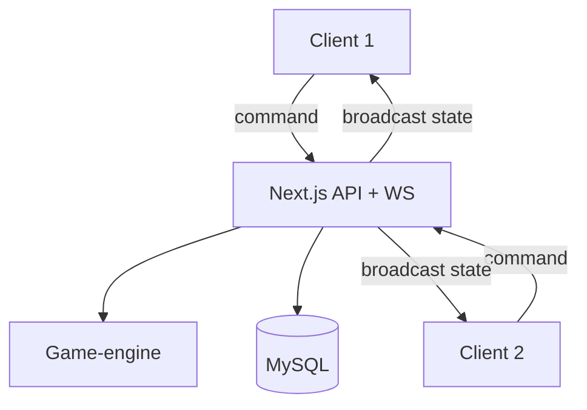

# Gamemodes en multiplayer

## Gamemodes — strategie

Eén **game-engine**; modes verschillen in configuratie en hooks, niet in duplicate SET-math.

### Mode registry

```typescript
const gameModes = {
  classic: classicMode,
  time_attack: timeAttackMode,
} as const;

type ModeId = keyof typeof gameModes;
```

UI en API refereren `modeId`; unknown mode → 400.

### Classic (M1)

- Config: § [Functionele specificatie](./03-functionele-specificatie.md)  
- Geen timer; score = aantal SETs.

### Time Attack (M3 — concept)

| Aspect | Gedrag |
|--------|--------|
| Duur | Bijv. 60s of 120s configureerbaar |
| Score | SETs + optioneel tijdbonus |
| Einde | `time_up` |
| Ongeldige SET | Optioneel -1s of -1 punt (productbesluit) |

Spec uitwerken vóór implementatie (zelfde structuur als Classic doc).

### Multiplayer Classic (M4 — concept)

| Aspect | Gedrag |
|--------|--------|
| Winnaar | Hoogste score bij einde deck / geen zetten |
| Beurt | **Variant A:** realtime race — eerste geldige SET claimt (server serialiseert) |
| | **Variant B:** turn-based — ADR vóór M4 |
| Gelijk spel | Zelfde seed + startbord voor fairness |

**Aanbeveling:** start met **realtime race** (eenvoudiger UX voor SET); server beslist conflicts.

## Multiplayer architectuur



### Message types (indicatief)

| Type | Richting | Inhoud |
|------|----------|--------|
| `JoinLobby` | C→S | lobbyId / invite |
| `StartGame` | C→S | host only |
| `GameCommand` | C→S | `{ gameId, action, clientSeq }` |
| `GameStateUpdate` | S→C | `{ gameId, version, state, events }` |
| `PlayerPresence` | S→C | connected/disconnected |

### Server validatie pipeline

1. Authenticate session.  
2. Load game row + version lock.  
3. Map DTO → `GameAction`.  
4. `applyAction` op canonical state.  
5. Bij success: persist + increment version + push clients.  
6. Bij failure: error naar client, geen version bump.

### Reconnect

- Client stuurt `lastKnownVersion`.  
- Server stuurt full state of diff (M4: full state voldoende).  
- Presence flag `connected` voor UI.

### Privacy

- Volledige deck/order: alleen server-side JSON.  
- Client krijgt: board, eigen score, publieke scores, timer — geen draw pile order.

## HTTP-first pad (M2–M3)

Voor solo en turn-light flows:

- `POST /api/games` — start  
- `POST /api/games/:id/actions` — actie  
- `GET /api/games/:id` — state poll  

Multiplayer M4 voegt WebSocket channel toe; HTTP blijft voor fallback.

## Testing multiplayer

- Integration: twee parallel clients simuleren in test.  
- Property: sequential commands ≡ single-thread apply opzelfde state.  
- Chaos: disconnect mid-command → state consistent.

## Anti-patterns (verboden)

- `if (multiplayer)` in `isValidSet`.  
- Client-side score authoritative.  
- Twee implementaties van SET-validatie (client “preview” mag **dezelfde** core functie aanroepen in worker of server only preview).
